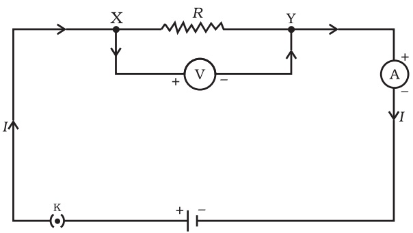

**Applying Ohm’s law [Eq. (11.5)], we get**

$$
H = I ^ { 2 }   R t\tag{11.21}
$$

**This is known as Joule’s law of heating. The law implies that heat produced in a resistor is (i) directly proportional to the square of current for a given resistance, (ii) directly proportional to resistance for a given current, and (iii) directly proportional to the time for which the current flows through the resistor. In practical situations, when an electric appliance is connected to a known voltage source, Eq. (11.21) is used after calculating the current through it, using the** relation $I   = V / R .$



Figure 11.13

A steady current in a purely resistive electric circuit

## Example 11.10

**An electric iron consumes energy at a rate of 840 W when heating is at the maximum rate and 360 W when the heating is at the minimum. The voltage is 220 V. What are the current and the resistance in each case?**

## Solution

```txt
From Eq. (11.19), we know that the power input is
P = V I
Thus the current I = P/V
(a) When heating is at the maximum rate,
I = 840 W/220 V = 3.82 A;
and the resistance of the electric iron is
R = V/I = 220 V/3.82 A = 57.60 Ω.
(b) When heating is at the minimum rate,
I = 360 W/220 V = 1.64 A;
and the resistance of the electric iron is
R = V/I = 220 V/1.64 A = 134.15 Ω.
```

## Example 11.11

**100 J of heat is produced each second in a 4** Ω **resistance. Find the potential difference across the resistor.**

```txt
Solution
H = 100 J, R = 4 Ω, t = 1 s, V = ?
From Eq. (11.21) we have the current through the resistor as
I √(H/Rt)
= √[100 J/(4 Ω × 1 s)]
= 5 A
Thus the potential difference across the resistor, V [from Eq. (11.5)] is
V = IR
= 5 A × 4 Ω
= 20 V.
```