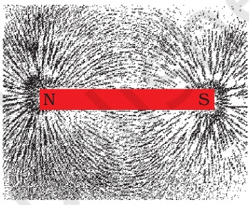

## 12.1 MAGNETIC FIELD AND FIELD LINES

**We are familiar with the fact that a compass needle gets deflected when brought near a bar magnet. A compass needle is, in fact, a small bar magnet. The ends of the compass needle point approximately towards north and south directions. The end pointing towards north is called north seeking or north pole. The other end that points towards south is called south seeking or south pole. Through various activities we have observed that like poles repel, while unlike poles of magnets attract each other.**

## Q U E S T I O N

**1. Why does a compass needle get deflected when brought near a bar magnet?**

## Activity 12.2

**Fix a sheet of white paper on a drawing board using some adhesive material.**

n **Place a bar magnet in the centre of it.**

**Sprinkle some iron filings uniformly around the bar magnet (Fig. 12.2). A salt-sprinkler may be used for this purpose.**

n **Now tap the board gently.**

n **What do you observe?**

Figure 12.2

Iron filings near the bar magnet align themselves along the field lines.

**The iron filings arrange themselves in a pattern as shown Fig. 12.2. Why do the iron filings arrange in such a pattern? What does this pattern demonstrate? The magnet exerts its influence in the region surrounding it. Therefore the iron filings experience a force. The force thus exerted makes iron filings to arrange in a pattern. The region surrounding a magnet, in which the force of the magnet can be detected, is said to have a magnetic field. The lines along which the iron filings align themselves represent magnetic field lines.**

**Are there other ways of obtaining magnetic field lines around a bar magnet? Yes, you can yourself draw the field lines of a bar magnet.**

## Activity 12.3

n **Take a small compass and a bar magnet.**

**Place the magnet on a sheet of white paper fixed on a drawing board, using some adhesive material.**

n **Mark the boundary of the magnet.**

**Place the compass near the north pole of the magnet. How does it behave? The south pole of the needle points towards the north pole of the magnet. The north pole of the compass is directed away from the north pole of the magnet.**