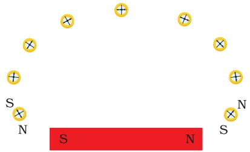
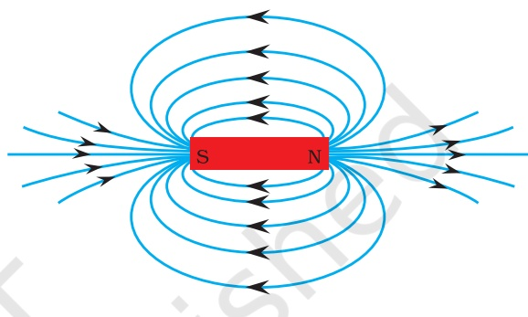

n **Mark the position of two ends of the needle.**

**Now move the needle to a new position such that its south pole occupies the position previously occupied by its north pole.**

**In this way, proceed step by step till you reach the south pole of the magnet as shown in Fig. 12.3.**

**Join the points marked on the paper by a smooth curve. This curve represents a field line.**

**Repeat the above procedure and draw as many lines as you can. You will get a pattern shown in Fig. 12.4. These lines represent the magnetic field around the magnet. These are known as magnetic field lines.**

**Observe the deflection in the compass needle as you move it along a field line. The deflection increases as the needle is moved towards the poles.**

Figure 12.3

Drawing a magnetic field line with the help of a compass needle

Figure 12.4 Field lines around a bar magnet

**Magnetic field is a quantity that has both direction and magnitude. The direction of the magnetic field is taken to be the direction in which a north pole of the compass needle moves inside it. Therefore it is taken by convention that the field lines emerge from north pole and merge at the south pole (note the arrows marked on the field lines in Fig. 12.4). Inside the magnet, the direction of field lines is from its south pole to its north pole. Thus the magnetic field lines are closed curves.**

**The relative strength of the magnetic field is shown by the degree of closeness of the field lines. The field is stronger, that is, the force acting on the pole of another magnet placed is greater where the field lines are crowded (see Fig. 12.4).**

**No two field-lines are found to cross each other. If they did, it would mean that at the point of intersection, the compass needle would point towards two directions, which is not possible.**

## 12.2 MAGNETIC FIELD DUE TO A CURRENT-CARRYING CONDUCTOR

**In Activity 12.1, we have seen that an electric current through a metallic conductor produces a magnetic field around it. In order to find the direction of the field produced let us repeat the activity in the following way –**