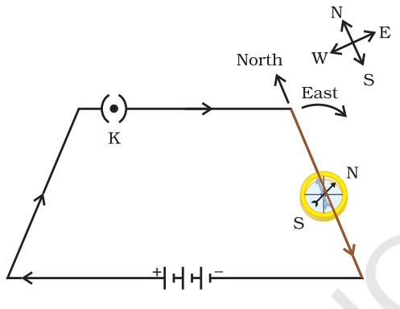
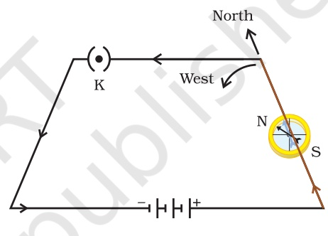

## Activity 12.4

**Take a long straight copper wire, two or three cells of 1.5 V each, and a plug key. Connect all of them in series as shown in Fig. 12.5 (a).**

n **Place the straight wire parallel to and over a compass needle.**

n **Plug the key in the circuit.**

**Observe the direction of deflection of the north pole of the needle. If the current flows from north to south, as shown in Fig. 12.5 (a), the north pole of the compass needle would move towards the east.**

**Replace the cell connections in the circuit as shown in Fig. 12.5 (b). This would result in the change of the direction of current through the copper wire, that is, from south to north.**

**Observe the change in the direction of deflection of the needle. You will see that now the needle moves in opposite direction, that is, towards the west [Fig. 12.5 (b)]. It means that the direction of magnetic field produced by the electric current is also reversed.**

(a)

(b)

Figure 12.5 A simple electric circuit in which a straight copper wire is placed parallel to and over a compass needle. The deflection in the needle becomes opposite when the direction of the current is reversed.

## 12.2.1 Magnetic Field due to a Current through a Straight Conductor

**What determines the pattern of the magnetic field generated by a current through a conductor? Does the pattern depend on the shape of the conductor? We shall investigate this with an activity.**

**We shall first consider the pattern of the magnetic field around a straight conductor carrying current.**

## Activity 12.5

**Take a battery (12 V), a variable resistance (or a rheostat), an ammeter (0–5 A), a plug key, connecting wires and a long straight thick copper wire.**

**Insert the thick wire through the centre, normal to the plane of a rectangular cardboard. Take care that the cardboard is fixed and does not slide up or down.**