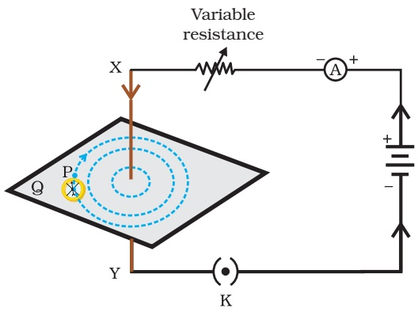
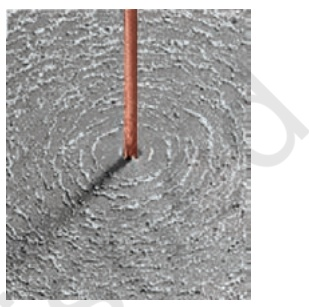

**Connect the copper wire vertically between the points X and Y, as shown in Fig. 12.6 (a), in series with the battery, a plug and key.**

**Sprinkle some iron filings uniformly on the cardboard. (You may use a salt sprinkler for this purpose.)**

**Keep the variable of the rheostat at a fixed position and note the current through the ammeter.**

**Close the key so that a current flows through the wire. Ensure that the copper wire placed between the points X and Y remains vertically straight.**

**Gently tap the cardboard a few times. Observe the pattern of the iron filings. You would find that the iron filings align themselves showing a pattern of concentric circles around the copper wire (Fig. 12.6).**

**What do these concentric circles represent? They represent the magnetic field lines.**

**How can the direction of the magnetic field be found? Place a compass at a point (say P) over a circle. Observe the direction of the needle. The direction of the north pole of the compass needle would give the direction of the field lines produced by the electric current through the straight wire at point P. Show the direction by an arrow.**

**Does the direction of magnetic field lines get reversed if the direction of current through the straight copper wire is reversed? Check it.**

(a)

(b)

Figure 12.6

(a) A pattern of concentric circles indicating the field lines of a magnetic field around a straight conducting wire. The arrows in the circles show the direction of the field lines. (b) A close up of the pattern obtained.

**What happens to the deflection of the compass needle placed at a given point if the current in the copper wire is changed? To see this, vary the current in the wire. We find that the deflection in the needle also changes. In fact, if the current is increased, the deflection also increases. It indicates that the magnitude of the magnetic field produced at a given point increases as the current through the wire increases.**

**What happens to the deflection of the needle if the compass is moved away from the copper wire but the current through the wire remains the same? To see this, now place the compass at a farther point from the conducting wire (say at point Q). What change do you observe? We see that the deflection in the needle decreases. Thus the magnetic field produced by a given current in the conductor decreases as the distance from it increases. From Fig. 12.6, it can be noticed that the concentric circles representing the magnetic field around a current-carrying straight wire become larger and larger as we move away from it.**

## 12.2.2 Right-Hand Thumb Rule

**A convenient way of finding the direction of magnetic field associated with a current-carrying conductor is given in Fig. 12.7.**