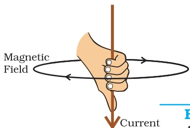
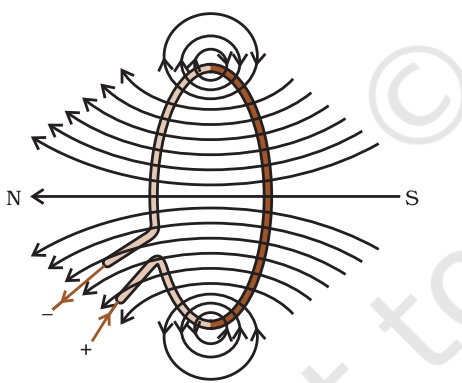

Figure 12.7 Right-hand thumb rule

**Imagine that you are holding a current-carrying straight conductor in your right hand such that the thumb points towards the direction of current. Then your fingers will wrap around the conductor in the direction of the field lines of the magnetic field, as shown in Fig. 12.7. This is known as the right-hand thumb rule\*.**

## Example 12.1

**A current through a horizontal power line flows in east to west direction. What is the direction of magnetic field at a point directly below it and at a point directly above it?**

## Solution

**The current is in the east-west direction. Applying the right-hand thumb rule, we get that the magnetic field (at any point below or above the wire) turns clockwise in a plane perpendicular to the wire, when viewed from the east end, and anti-clockwise, when viewed from the west end.**

## Q U E S T I O N S

**1. Draw magnetic field lines around a bar magnet.**

**2. List the properties of magnetic field lines.**

**3. Why don’t two magnetic field lines intersect each other?**

## 12.2.3 Magnetic Field due to a Current through a Circular Loop

Figure 12.8

Magnetic field lines of the field produced by a current-carrying circular loop

**We have so far observed the pattern of the magnetic field lines produced around a current-carrying straight wire. Suppose this straight wire is bent in the form of a circular loop and a current is passed through it. How would the magnetic field lines look like? We know that the magnetic field produced by a current-carrying straight wire depends inversely on the distance from it. Similarly at every point of a current-carrying circular loop, the concentric circles representing the magnetic field around it would become larger and larger as we move away from the wire (Fig. 12.8). By the time we reach at the centre of the circular loop, the arcs of these big circles would appear as straight lines. Every point on the wire carrying current would give rise to the magnetic field appearing as straight lines at the center of the loop. By applying the right hand rule, it is easy to check that every section of the wire contributes to the magnetic field lines in the same direction within the loop.**

**\* This rule is also called Maxwell’s corkscrew rule. If we consider ourselves driving a corkscrew in the direction of the current, then the direction of the rotation of corkscrew is the direction of the magnetic field.**