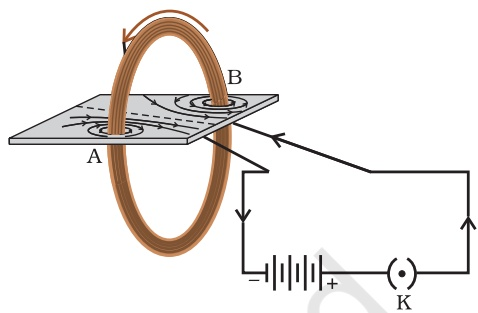
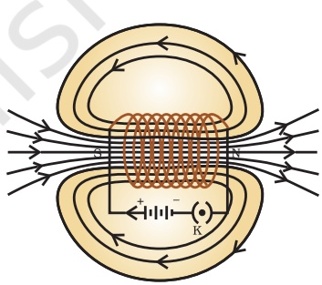
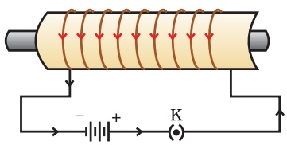

**We know that the magnetic field produced by a current-carrying wire at a given point depends directly on the current passing through it. Therefore, if there is a circular coil having n turns, the field produced is n times as large as that produced by a single turn. This is because the current in each circular turn has the same direction, and the field due to each turn then just adds up.**

## Activity 12.6

**Take a rectangular cardboard having two holes. Insert a circular coil having large number of turns through them, normal to the plane of the cardboard.**

**Connect the ends of the coil in series with a battery, a key and a rheostat, as shown in Fig. 12.9.**

n **Sprinkle iron filings uniformly on the cardboard.**

**Plug the key.**

**Tap the cardboard gently a few times. Note the pattern of the iron filings that emerges on the cardboard.**

Figure 12.9 Magnetic field produced by a currentcarrying circular coil.

## 12.2.4 Magnetic Field due to a Current in a Solenoid

**A coil of many circular turns of insulated copper wire wrapped closely in the shape of a cylinder is called a solenoid. The pattern of the magnetic field lines around a current-carrying solenoid is shown in Fig. 12.10. Compare the pattern of the field with the magnetic field around a bar magnet (Fig. 12.4). Do they look similar? Yes, they are similar. In fact, one end of the solenoid behaves as a magnetic north pole, while the other behaves as the south pole. The field lines inside the solenoid are in the form of parallel straight lines. This indicates that the magnetic field is the same at all points inside the solenoid. That is, the field is uniform inside the solenoid.**

Figure 12.10 Field lines of the magnetic field through and around a current carrying solenoid.

**A strong magnetic field produced inside a solenoid can be used to magnetise a piece of magnetic material, like soft iron, when placed inside the coil (Fig. 12.11). The magnet so formed is called an electromagnet.**

## Q U E S T I O N S

Figure 12.11

A current-carrying solenoid coil is used to magnetise steel rod inside it – an electromagnet.

**1. Consider a circular loop of wire lying in the plane of the table. Let the current pass through the loop clockwise. Apply the right-hand rule to find out the direction of the magnetic field inside and outside the loop.**

**2. The magnetic field in a given region is uniform. Draw a diagram to represent it.**

