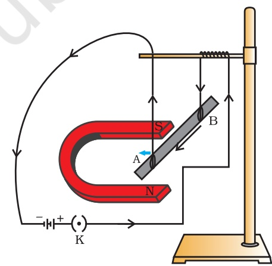

**3. Choose the correct option.**

**The magnetic field inside a long straight solenoid-carrying current**

**(a) is zero.**

**(b) decreases as we move towards its end.**

**(c) increases as we move towards its end.**

**(d) is the same at all points.**

## 12.3 FORCE ON A CURRENT-CARRYING CONDUCTOR IN A MAGNETIC FIELD

**We have learnt that an electric current flowing through a conductor produces a magnetic field. The field so produced exerts a force on a magnet placed in the vicinity of the conductor. French scientist Andre Marie Ampere (1775–1836) suggested that the magnet must also exert an equal and opposite force on the current-carrying conductor. The force due to a magnetic field acting on a current-carrying conductor can be demonstrated through the following activity.**

## Activity 12.7

**Take a small aluminium rod AB (of about 5 cm). Using two connecting wires suspend it horizontally from a stand, as shown in Fig. 12.12.**

**Place a strong horse-shoe magnet in such a way that the rod lies between the two poles with the magnetic field directed upwards. For this put the north pole of the magnet vertically below and south pole vertically above the aluminium rod (Fig. 12.12).**

**Connect the aluminium rod in series with a battery, a key and a rheostat.**

**Now pass a current through the aluminium rod from end B to end A.**

**What do you observe? It is observed that the rod is displaced towards the left. You will notice that the rod gets displaced.**

**Reverse the direction of current flowing through the rod and observe the direction of its displacement. It is now towards the right.**

**Why does the rod get displaced?**

## Figure 12.12

**A current-carrying rod, AB, experiences a force perpendicular to its length and the magnetic field. Support for the magnet is not shown here, for simplicity.**

**The displacement of the rod in the above activity suggests that a force is exerted on the current-carrying aluminium rod when it is placed in a magnetic field. It also suggests that the direction of force is also reversed when the direction of current through the conductor is reversed. Now change the direction of field to vertically downwards by interchanging the two poles of the magnet. It is once again observed that**