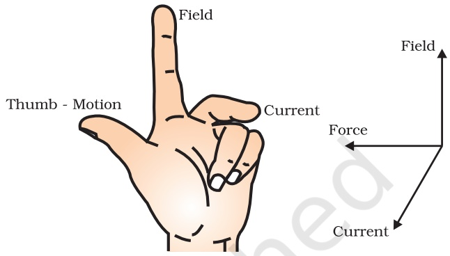
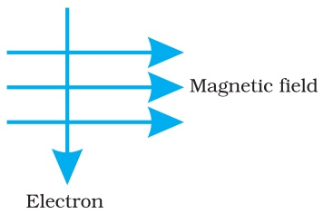

**the direction of force acting on the current-carrying rod gets reversed. It shows that the direction of the force on the conductor depends upon the direction of current and the direction of the magnetic field. Experiments have shown that the displacement of the rod is largest (or the magnitude of the force is the highest) when the direction of current is at right angles to the direction of the magnetic field. In such a condition we can use a simple rule to find the direction of the force on the conductor.**

**In Activity 12.7, we considered the direction of the current and that of the magnetic field perpendicular to each other and found that the force is perpendicular to both of them. The three directions can be illustrated through a simple rule, called Fleming’s left-hand rule. According to this rule, stretch the thumb, forefinger and middle finger of your left hand such that they are mutually perpendicular (Fig. 12.13). If the first finger points in the direction of magnetic field and the second finger in the direction of current, then the thumb will point in the direction of motion or the force acting on the conductor.**

Figure 12.13 Fleming’s left-hand rule

**Devices that use current-carrying conductors and magnetic fields include electric motor, electric generator, loudspeakers, microphones and measuring instruments.**

## Example 12.2

**An electron enters a magnetic field at right angles to it, as shown in Fig. 12.14. The direction of force acting on the electron will be (a) to the right.**

**(b) to the left.**

**(c) out of the page.**

**(d) into the page.**

Figure 12.14

## Solution

**Answer is option (d). The direction of force is perpendicular to the direction of magnetic field and current as given by Fleming’s left hand rule. Recall that the direction of current is taken opposite to the direction of motion of electrons. The force is therefore directed into the page.**

## Q U E S T I O N S

## 1. Which of the following property of a proton can change while it moves freely in a magnetic field? (There may be more than one correct answer.)

**(a) mass**

**(c) velocity**

**(b) speed**

**(d) momentum**

