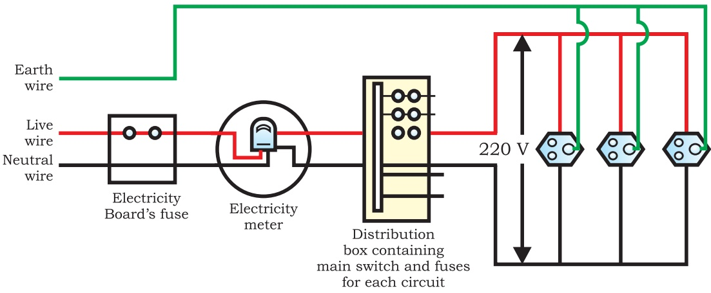

Figure 12.15 A schematic diagram of one of the common domestic circuits

**Figure 12.15 gives a schematic diagram of one of the common domestic circuits. In each separate circuit, different appliances can be connected across the live and neutral wires. Each appliance has a separate switch to ‘ON’/‘OFF’ the flow of current through it. In order that each appliance has equal potential difference, they are connected parallel to each other.**

**Electric fuse is an important component of all domestic circuits. We have already studied the principle and working of a fuse in the previous chapter (see Section 11.7). A fuse in a circuit prevents damage to the appliances and the circuit due to overloading. Overloading can occur when the live wire and the neutral wire come into direct contact. (This occurs when the insulation of wires is damaged or there is a fault in the appliance.) In such a situation, the current in the circuit abruptly increases. This is called short-circuiting. The use of an electric fuse prevents the electric circuit and the appliance from a possible damage by stopping the flow of unduly high electric current. The Joule heating that takes place in the fuse melts it to break the electric circuit. Overloading can also occur due to an accidental hike in the supply voltage. Sometimes overloading is caused by connecting too many appliances to a single socket.**

## Q U E S T I O N S

**1. Name two safety measures commonly used in electric circuits and appliances.**

**2. An electric oven of 2 kW power rating is operated in a domestic electric circuit (220 V) that has a current rating of 5 A. What result do you expect? Explain.**

**3. What precaution should be taken to avoid the overloading of domestic electric circuits?**

