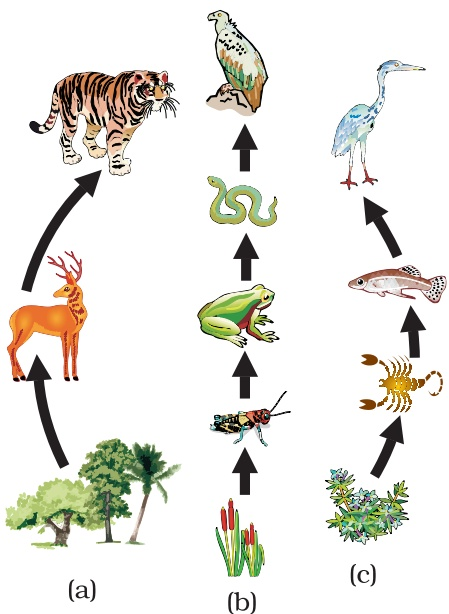
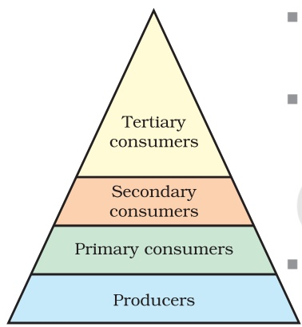

Figure 13.1 Food chain in nature (a) in forest, (b) in grassland and (c) in a pond

Tertiary consumers

**We know that the food we eat acts as a fuel to provide us energy to do work. Thus the interactions among various components of the environment involves flow of energy from one component of the system to another. As we have studied, the autotrophs capture the energy present in sunlight and convert it into chemical energy. This energy supports all the activities of the living world. From autotrophs, the energy goes to the heterotrophs and decomposers. However, as we saw in the previous Chapter on ‘Sources of Energy’, when one form of energy is changed to another, some energy is lost to the environment in forms which cannot be used again. The flow of energy between various components of the environment has been extensively studied and it has been found that –**

The green plants in a terrestrial ecosystem capture about **1% of the energy of sunlight that falls on their leaves and convert it into food energy.**

Primary consumers

Secondary consumers

## 13.1.1 Food Chains and Webs

Producers

**In Activity 13.4 we have formed a series of organisms feeding on one another. This series or organisms taking part at various biotic levels form a food chain (Fig. 13.1).**

**Figure 13.2 Trophic levels**

**Each step or level of the food chain forms a trophic level. The autotrophs or the producers are at the first trophic level. They fix up the solar energy and make it available for heterotrophs or the consumers. The herbivores or the primary consumers come at the second, small carnivores or the secondary consumers at the third and larger carnivores or the tertiary consumers form the fourth trophic level (Fig. 13.2).**

**When green plants are eaten by primary consumers, a great deal of energy is lost as heat to the environment, some amount goes into digestion and in doing work and the rest goes towards growth and reproduction. An average of 10% of the food eaten is turned into its own body and made available for the next level of consumers.**

**Therefore, 10% can be taken as the average value for the amount of organic matter that is present at each step and reaches the next level of consumers.**

**Since so little energy is available for the next level of consumers, food chains generally consist of only three or four steps. The loss of energy at each step is so great that very little usable energy remains after four trophic levels.**

**There are generally a greater number of individuals at the lower trophic levels of an ecosystem, the greatest number is of the producers.**

**The length and complexity of food chains vary greatly. Each organism is generally eaten by two or more other kinds of organisms which in turn are eaten by several other organisms. So instead of a straight line food chain, the relationship can be shown as a series of branching lines called a food web (Fig. 13.3).**