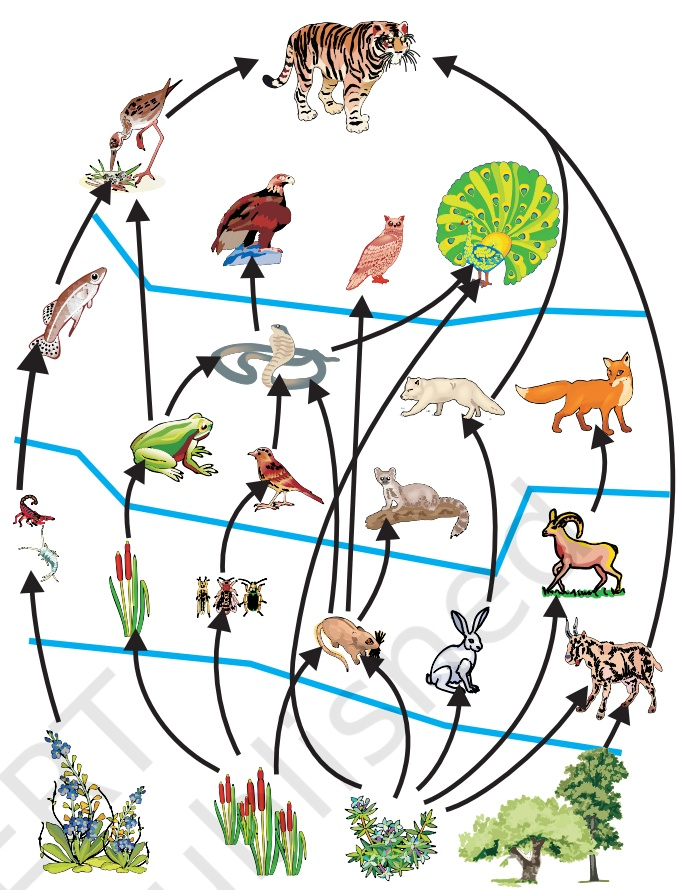
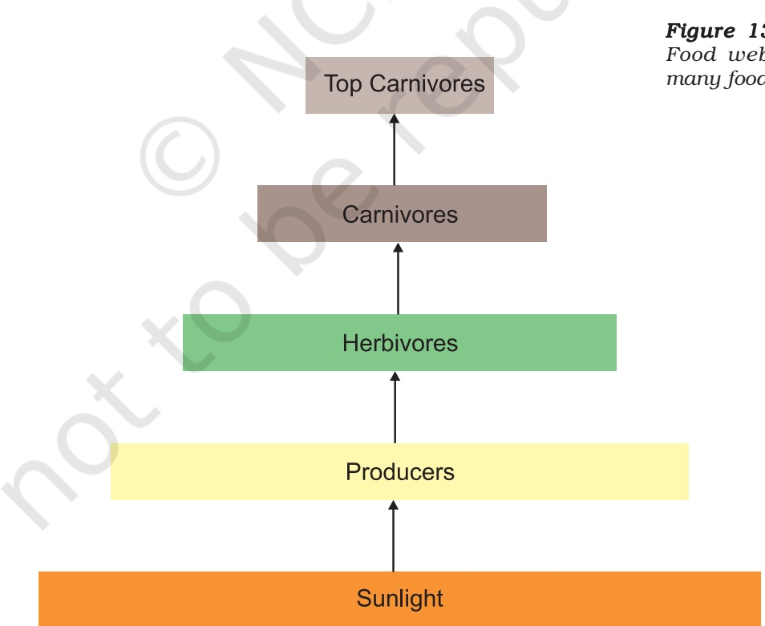

**From the energy flow diagram (Fig. 13.4), two things become clear. Firstly, the flow of energy is unidirectional. The energy that is captured by the autotrophs does not revert back to the solar input and the energy which passes to the herbivores does not come back to autotrophs. As it moves progressively through the various trophic levels it is no longer available to the previous level. Secondly, the energy available at each trophic level gets diminished progressively due to loss of energy at each level.**

**Another interesting aspect of food chain is how unknowingly some harmful chemicals enter our bodies through the food chain. You have read in Class IX how water gets polluted. One of the reasons is the use of several pesticides and other chemicals to protect our crops from diseases and pests. These chemicals are either washed down into the soil or into the water bodies. From the soil, these are absorbed by the plants along with water and minerals, and from the water bodies these are taken up by aquatic plants**

Figure 13.3 Food web, consisting of many food chains

Figure 13.4 Diagram showing flow of energy in an ecosystem