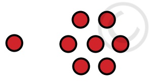
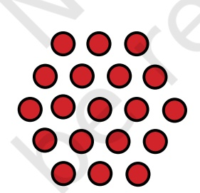
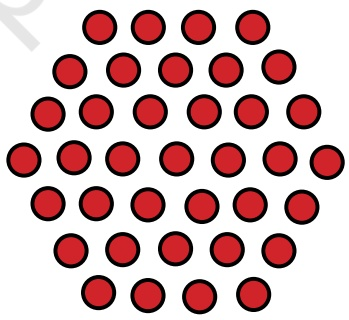

## Figure it Out

1. Copy the pictorial representations of the number sequences in Table 2 in your notebook, and draw the next picture for each sequence!

2. Why are 1, 3, 6, 10, 15, … called **triangular numbers**? Why are 1, 4, 9, 16, 25, … called **square numbers** or **squares**? Why are 1, 8, 27, 64, 125, … called **cubes**?

3. You will have noticed that 36 is both a triangular number and a square number! That is, 36 dots can be arranged perfectly both in a triangle and in a square. Make pictures in your notebook illustrating this!

This shows that the same number can be represented differently, and play different roles, depending on the context. Try representing some other numbers pictorially in different ways!

4. What would you call the following sequence of numbers?

7

1

**19**

**37**

That’s right, they are called **hexagonal numbers**! Draw these in your notebook. What is the next number in the sequence?

5. Can you think of pictorial ways to visualise the sequence of Powers of 2? Powers of 3?