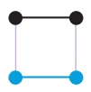
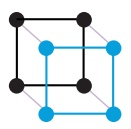
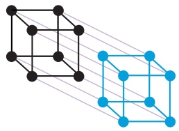

Here is one possible way of thinking about Powers of 2:

1

2

4

8

**16**

## 1.4 Relations among Number Sequences

Sometimes, number sequences can be related to each other in surprising ways.

**Example**: What happens when we start adding up odd numbers?

$$
1 = 1
$$

$$
1 + 3 = 4
$$

$$
1+3+5=9
$$

$$
1+3+5+7=16
$$

$$
1+3+5+7+9=25
$$

$$
1+3+5+7+9+11=36
$$

This is a really beautiful pattern!

Why does this happen? Do you think it will happen forever?

The answer is that the pattern does happen forever. But why? As mentioned earlier, the reason why the pattern happens is just as important and exciting as the pattern itself.

## A picture can explain it

Visualising with a picture can help explain the phenomenon. Recall that square numbers are made by counting the number of dots in a square grid.

How can we partition the dots in a square grid into odd numbers of dots: 1, 3, 5, 7,... ?

Think about it for a moment before reading further!