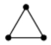
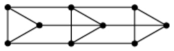
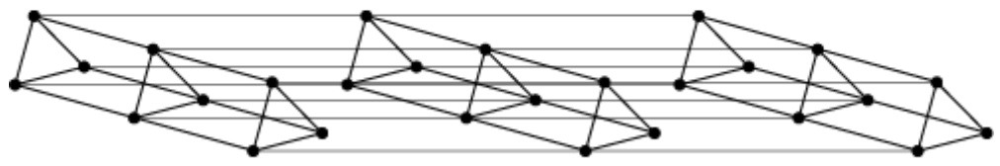
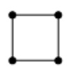
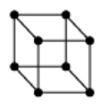
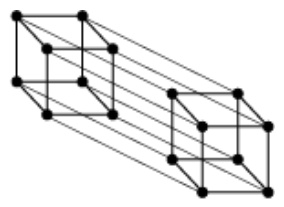
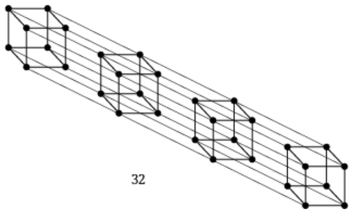

**Q.4. What would you call the following sequence of numbers? Ans.** 61.

**Q.5. Can you think of pictorial ways to visualise the sequence of powers of 2? powers of 3?**

**Ans.** Sequence of powers of 2—given on page 6

Sequence of powers of 3- One of the ways could be –

3

9

27

2

4

8

16

## Page No. 7

**Section 1.4**

**By drawing a similar picture, can you say what is the sum of the first 10 odd numbers? Ans.** 100