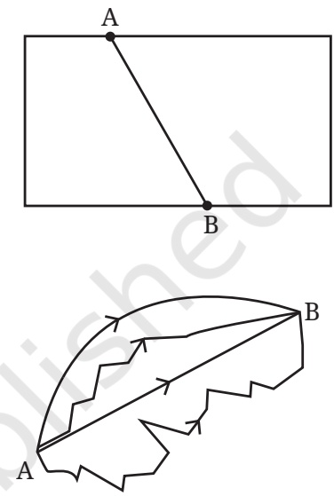
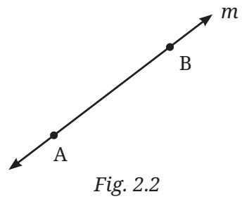

Z, P and T. These points are read as ‘Point Z’, ‘Point P’ and ‘Point T’. Of course, the dots represent precise locations and must be imagined to be invisibly thin.

## 2.2 Line Segment

Fold a piece of paper and unfold it. Do you see a crease? This gives the idea of a line segment. It has two end points, A and B.

Mark any two points A and B on a sheet of paper. Try to connect A to B by various routes (Fig. 2.1).

What is the shortest route from A to B? This shortest path from point A to Point B (including A and B) as shown here is called the **line segment** from A to B. It is denoted by either AB or BA. The points A and B are called the **end points** of the line segment AB.

Fig. 2.1

## 2.3 Line

Imagine that the line segment from A to B (i.e., AB) is extended beyond A in one direction and beyond B in the other direction without any end (see Fig. 2.2). This is a model for a **line.** Do you think you can draw a complete picture of a line? No. Why?

A line through two points A and B is written as $\overrightarrow { \mathrm { A B } }$ . It extends forever in both directions. Sometimes a line is denoted by a letter like l or m.

Observe that any two points determine a unique line that passes through both of them.