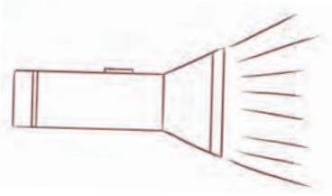
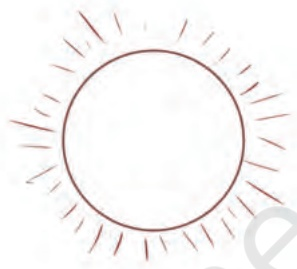
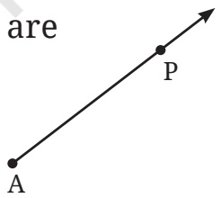

## 2.4 Ray

A **ray** is a portion of a line that starts at one point (called the **starting point** or **initial point** of the ray) and goes on endlessly in a direction. The following are some models for a ray:

Beam of light from a lighthouse

Ray of light from a torch

Sun rays

Look at the diagram (Fig. 2.3) of a ray. Two points are marked on it. One is the starting point A and the other is a point P on the path of the ray. We then denote the ray by $\overrightarrow { \mathrm { A P } } .$ A

Fig. 2.3

## Figure it Out

1.

Rihan marked a point on a piece of paper. How many lines can he draw that pass through the point?

Sheetal marked two points on a piece of paper. How many different lines can she draw that pass through both of the points?

Can you help Rihan and Sheetal find their answers?