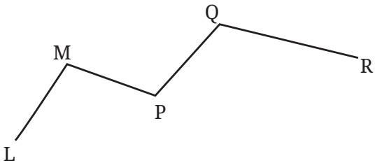
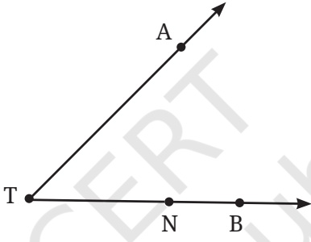
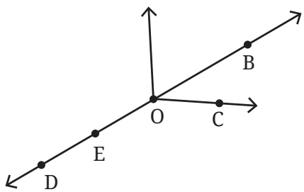

2. Name the line segments in Fig. 2.4. Which of the five marked points are on exactly one of the line segments? Which are on two of the line segments?

Fig. 2.4

3. Name the rays shown in Fig. 2.5. Is T the starting point of each of these rays?

Fig. 2.5

4. Draw a rough figure and write labels appropriately to illustrate each of the following: a. $\overrightarrow { \mathrm { O P } }$ and $\overrightarrow { \mathrm { { \vec { O } } \vec { Q } } }$ meet at O. b. $\overrightarrow { \mathrm { X Y } }$ and $\overrightarrow { \mathrm { p Q } }$ intersect at point M. c. Line l contains points E and F but not point D. d. Point P lies on AB.

5. In Fig. 2.6, name: a. Five points b. A line c. Four rays d. Five line segments

Fig. 2.6