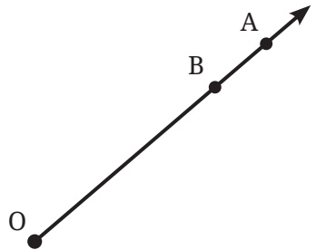
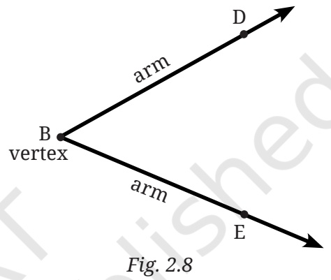

6. Here is a ray $\overrightarrow { \mathrm { O A } }$ (Fig. 2.7). It starts at O and passes through the point A. It also passes through the point B.

a. Can you also name it as $\overrightarrow { \mathrm { O B }   \mathrm { ? } }$ Why? b. Can we write $\overrightarrow { \mathrm { O A } }$ as $\overrightarrow { \mathrm { A O } } \overrightarrow { \mathrm { ^ { \prime } } }$ Why or why not?

Fig. 2.7

## 2.5 Angle

An angle is formed by two rays having a common starting point. Here is an angle formed by rays BD and $\overrightarrow { \mathrm { B E } }$ where B is the common starting point (Fig. 2.8).

The point B is called the **vertex** of the angle, and the rays BD and BE are called $\overrightarrow { \mathrm { B E } }$ the **arms** of the angle. How can we name

this angle? We can simply use the vertex and say that it is the Angle B. To be clearer, we use a point on each of the arms together with the vertex to name the angle. In this case, we name the angle as Angle DBE or Angle EBD. The word angle can be replaced by the symbol ‘∠’, i.e., ∠DBE or ∠EBD. Note that in specifying the angle, the vertex is always written as the middle letter.

To indicate an angle, we use a small curve at the vertex (refer to Fig. 2.9).

Vidya has just opened her book. Let us observe her opening the cover of the book in different scenarios.

Case 1

Case 2

Case 3

Case 4

Case 5

Case 6