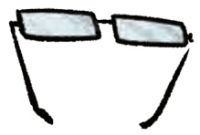
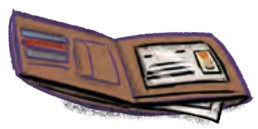
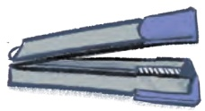
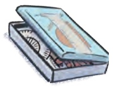
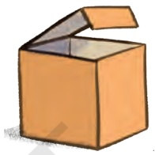
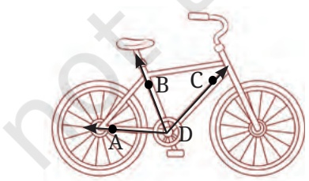
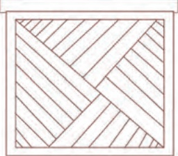

Look at the pictures of spectacles, wallet and other common objects. Identify the angles in them by marking out their arms and vertices.

Do you see how these angles are formed by turning one arm with respect to the other?

## Teacher’s Note

Teacher needs to organise various activities with the students to recognise the size of an angle as a measure of rotation.

## O Figure it Out

1. Can you find the angles in the given pictures? Draw the rays forming any one of the angles and name the vertex of the angle.

