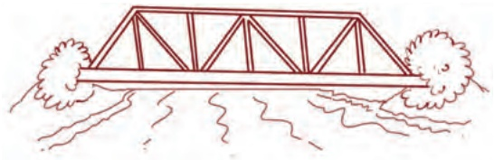
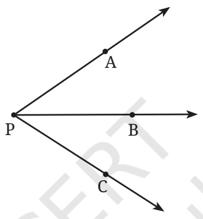
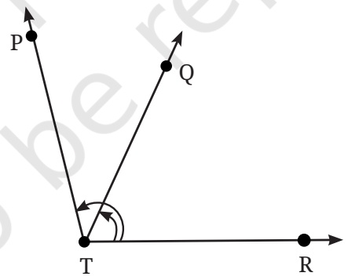

2. Draw and label an angle with arms $S T$ and SR.

3. Explain why $\angle APB$ cannot be labelled as $\angle P .$

4.	 Name the angles marked in the given figure.

5. Mark any three points on your paper that are not on one line. Label them A, B, C. Draw all possible lines going through pairs of these points. How many lines do you get? Name them. How many angles can you name using A, B, C? Write them down, and mark each of them with a curve as in Fig. 2.9.