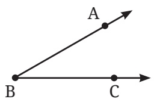
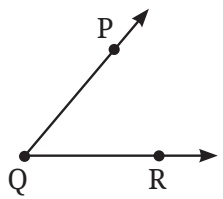
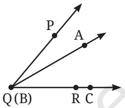
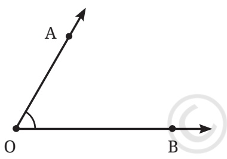
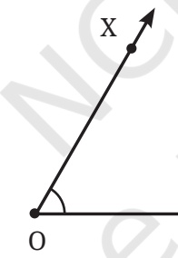
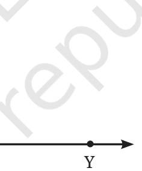
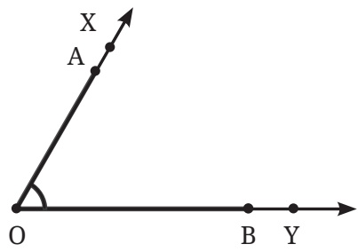

## Comparing angles by superimposition

Any two angles can be compared by placing them one over the other, i.e., by superimposition. While superimposing, the vertices of the angles must overlap.

After superimposition, it becomes clear which angle is smaller and which is larger.

The picture shows the two angles superimposed. It is now clear that ∠PQR is larger than $\angle  ABC$

**Equal angles.** Now consider $\angle  AOB$ and $\angle \mathrm { X O Y }$ in the figure. Which is greater?

The corners of both of these angles match and the arms overlap with each other, $\mathrm{i.e.,OA\leftrightarrow OX}$ and $\mathrm { O B \leftrightarrow O Y . S o }$ , the angles are **equal** in size.

The reason these angles are considered to be equal in size is because when we visualise each of these angles as being formed out of rotation, we can see that there is an equal amount of rotation needed to move $\overrightarrow { \mathrm { O B } }$ to $\overrightarrow { \mathrm { O A } }$ and $\overrightarrow { \mathrm { O Y } }$ to $\overrightarrow { \mathrm { O X } }$

From the point of view of superimposition, when two angles are superimposed, and the common vertex and the two rays of both angles lie on top of each other, then the sizes of the angles are equal.