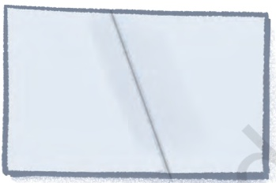
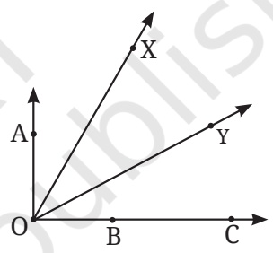
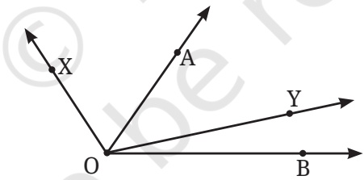
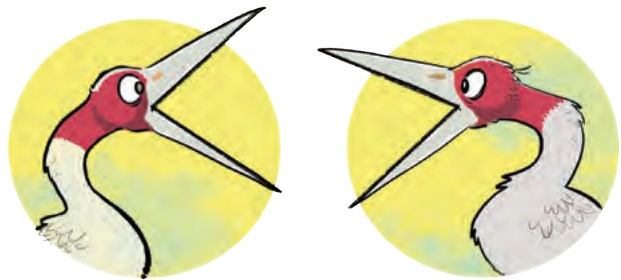

## Figure it Out

1. Fold a rectangular sheet of paper, then draw a line along the fold

created. Name and compare the angles formed between the fold and the sides of the paper. Make different angles by folding a rectangular sheet of paper and compare the angles. Which is the largest and smallest angle you made?

2. In each case, determine which angle is greater and why.

a. $\angle \mathrm{AOB}  or  \angle \mathrm{XOY}$

b. $\angle \mathrm{AOB}  or  \angle \mathrm{XOB}$

c. $\angle \mathrm{XOB}  or  \angle \mathrm{XOC}$

Discuss with your friends on how you decided which one is greater.

3. Which angle is greater: ∠XOY or ∠AOB? Give reasons.

**Comparing angles without superimposition**

Two cranes are arguing about who can open their mouth wider, i.e., who is making a bigger angle.

Let us first draw their angles. How do we know which one is bigger? As seen

Fig. 2.10