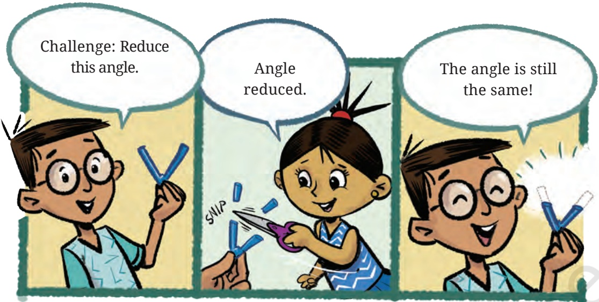
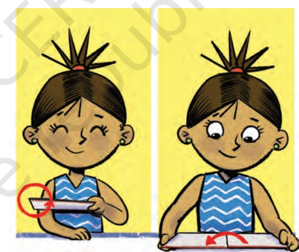
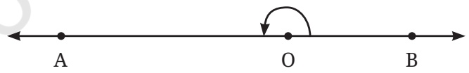

## 2.8 Special Types of Angles

Let us go back to Vidya’s notebook and observe her opening the cover of the book in different scenarios.

She makes a full turn of the cover when she has to write while holding the book in her hand.

She makes a half turn of the cover when she has to open it on her table. In this case,

observe the arms of the angle formed. They lie in a straight line. Such an angle is called a **straight angle**.

Fig. 2.11

Let us consider a straight angle $\angle \mathrm { A O B }$ . Observe that any ray $\overrightarrow { \mathrm { O C } }$ divides it into two angles, $\angle AOC$ and $\angle \mathrm { C O B }$