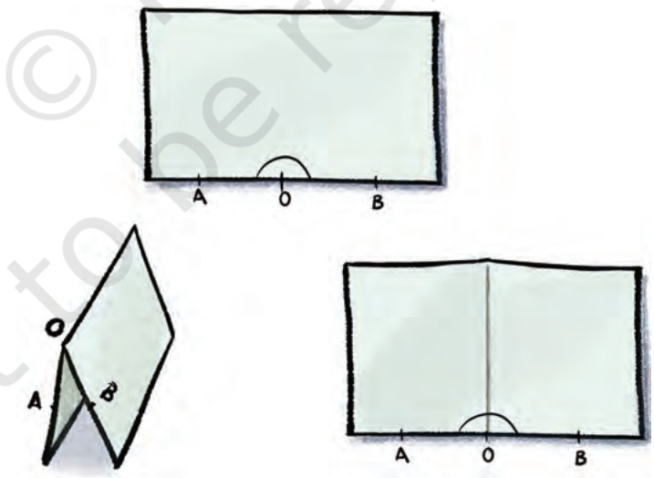
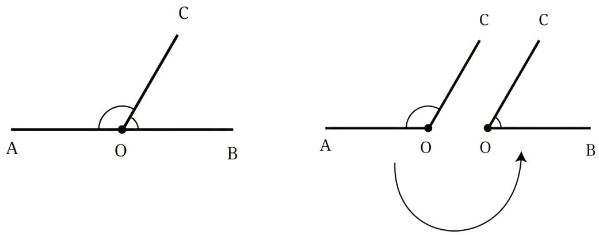

Is it possible to draw $\overrightarrow { \mathrm { O C } }$ such that the two angles are equal to each other in size?

## Let’s Explore

We can try to solve this problem using a piece of paper. Recall that when a fold is made, it creates a crease which is straight.

Take a rectangular piece of paper and on one of its sides, mark the straight angle AOB. By folding, try to get a line (crease) passing through O that divides ∠AOB into two equal angles.

How can it be done?

Fold the paper such that OB overlaps with OA. Observe the crease and the two angles formed.