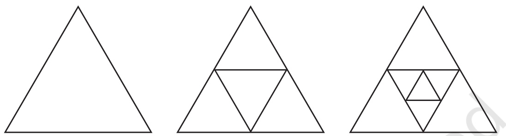
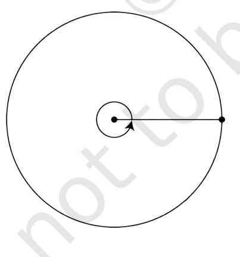
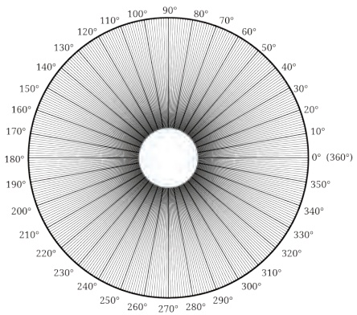

3. Do you know what the words acute and obtuse mean? Acute means sharp and obtuse means blunt. Why do you think these words have been chosen?

4. Find out the number of acute angles in each of the figures below.

What will be the next figure and how many acute angles will it have? Do you notice any pattern in the numbers?

## 2.9 Measuring Angles

We have seen how to compare two angles. But can we actually quantify how big an angle is using a number without having to compare it to another angle?

We saw how various angles can be compared using a circle. Perhaps a circle could be used to assign measures for angles?

Fig. 2.12

To assign precise measures to angles, mathematicians came up with an idea. They divided the angle in the centre of the circle into