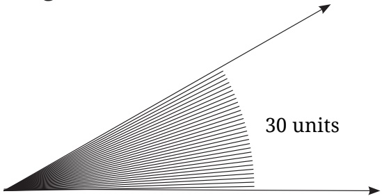
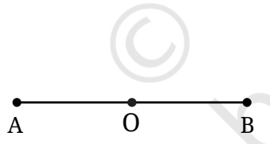
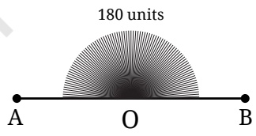
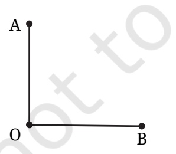
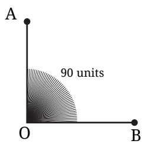

360 equal angles or parts. The angle measure of each of these unit parts is 1 degree, which is written as 1°.

This unit part is used to assign measure to any angle: the measure of an angle is the number of $1 ^ { \circ }$ unit parts it contains inside it. For example, see this figure:

It contains 30 units of 1° angle and so we say that its angle measure is $3 0 ^ { \circ }$ **Measures of different angles:** What is the measure of a full turn in degrees? As we have taken it to contain 360 degrees, its measure is $3 6 0 ^ { \circ }$

What is the measure of a straight angle in degrees? A straight angle is half of a full turn. As a full-turn is $3 6 0 ^ { \circ } ]$ , a half turn is $1 8 0 ^ { \circ }$ What is the measure of a right angle in degrees? Two right angles together form a straight angle. As a straight angle measures $1 8 0 ^ { \circ } ,$ , a right angle measures 90°.

**A pinch of history**

A full turn has been divided into $3 6 0 ^ { \circ }$ . Why 360? The reason why we use $3 6 0 ^ { \circ }$ today is not fully known. The division of a circle into