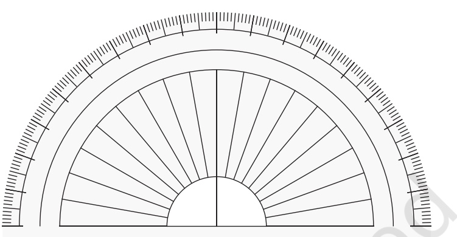
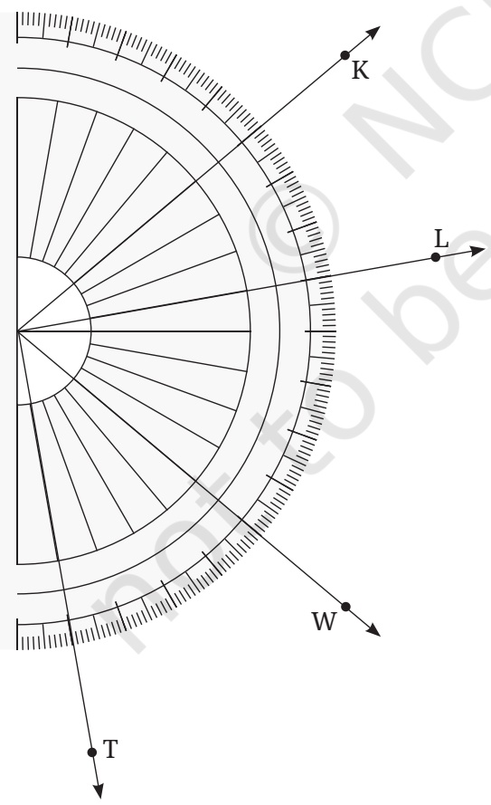

## Unlabelled protractor

Here is a protractor. Do you see the straight angle at the center

divided into 180 units of 1 degree? Only part of the lines dividing the straight angle are visible, though!

Starting from the marking on the rightmost point of the base, there is a long mark for every $1 0 ^ { \circ }$ . From every such long mark, there is a medium sized mark after $5 ^ { \circ }$

## Figure it out

A

Write the measures of the following angles:

$$
a.  \angle  KAL
$$

Notice that the vertex of this angle coincides with the centre of the protractor. So the number of units of 1 degree angle between KA and AL gives the measure of ∠KAL. By counting, we get —

$$
\angle KAL = 30^{\circ}
$$

Making use of the medium sized and large sized marks, is it possible to count the number of units in 5s or 10s?

b. $\angle \mathrm { W A L }$

$$
$\mathtt { C } .$ $\angle \mathrm { T A K }$
$$