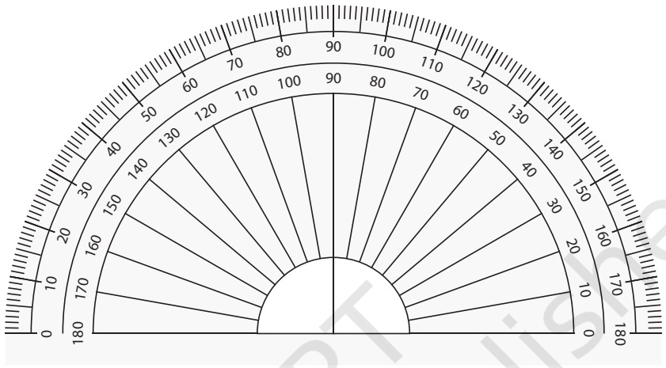
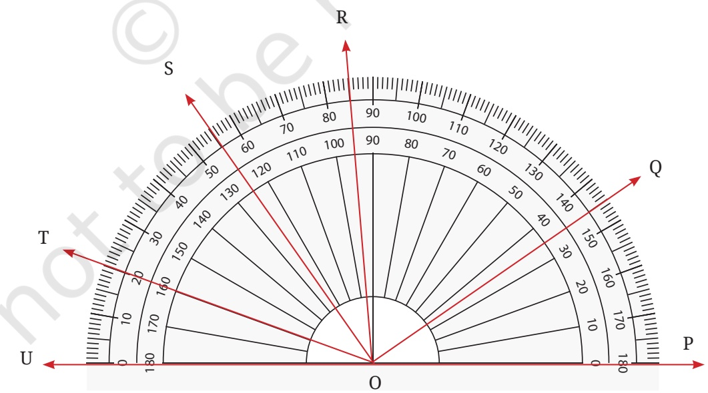

## Labelled protractor

This is a protractor that you find in your geometry box. It would appear similar to the protractor above except that there are numbers written on it. Will these make it easier to read the angles?

There are two sets of numbers on the protractor: one increasing from right to left and the other increasing from left to right. Why does it include two sets of numbers?

Name the different angles in the figure and write their measures.

