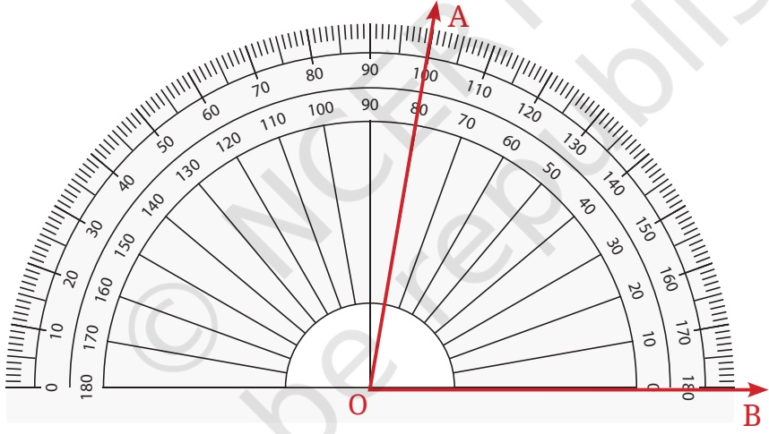

Did you include angles such as ∠TOQ?

Which set of markings did you use — inner or outer?

What is the measure of ∠TOS?

Can you use the numbers marked to find the angle without counting the number of markings?

Here, OT and OS pass through the numbers 20 and 55 on the outer scale. How many units of 1 degree are contained between these two arms?

Can subtraction be used here?

## How can we measure angles directly without having to subtract?

Place the protractor so the center is on the vertex of the angle.

Align the protractor so that one the arms passes through the 0º mark as in the picture below.

What is the degree measure of $\angle  AOB?$

## Make your own Protractor!

You may have wondered how the different equally spaced markings are made on a protractor. We will now see how we can make some of them!

1. Draw a circle of a convenient radius on a sheet of paper. Cut out the circle (Fig. 2.13). A circle or one full turn is 360°.

2. Fold the circle to get two equal halves and cut it through the crease to get a semicircle. Write ‘0°’ in the bottom right corner of the semicircle.