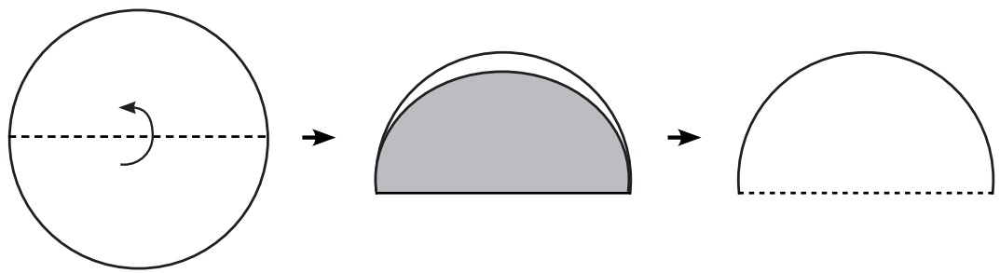
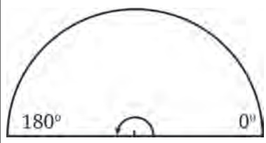
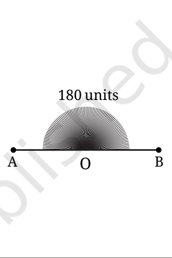
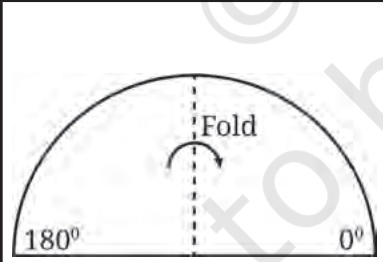
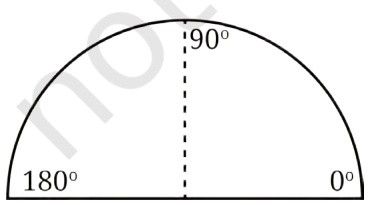
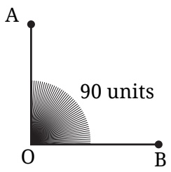

Fig. 2.13

Fig. 2.14

The measure of half a circle is $\frac { 1 } { 2 }$ of a full turn. (Fig. 2.14) So, the measure of half a turn $= \frac { 1 } { 2 }$ of $= 1 8 0 ^ { \circ } .$

Thus, write $1 8 0 ^ { \circ }$ in the left bottom corner of the semicircle.

3. Fold the semi-circular sheet in half as shown in Fig. 2.15 to form a quarter circle.

<table><tr><td> X   $= \frac { 1 } { 2 }$ </td><td>measure of a The  $\frac { 1 } { 4 }$  quarter circle is of a full turn. The measure of a  $\frac { 1 } { 4 }$   $= \frac{1}{4}$  of  $3 6 0 ^ { \circ } =$  turn  $\mathbf { a } { \frac { 1 } { 4 } }$  Or, the measure of  $\operatorname* { t u r n } = { \frac { 1 } { 2 } }$  of a half turn of  $1 8 0 ^ { \circ } =$ </td><td></td></tr></table>