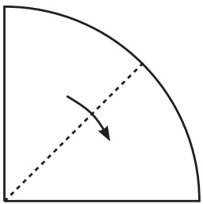
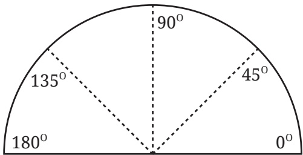
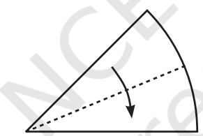
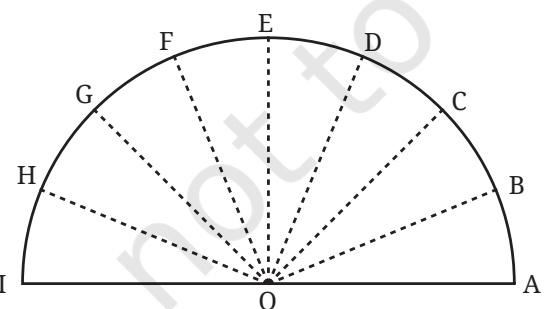
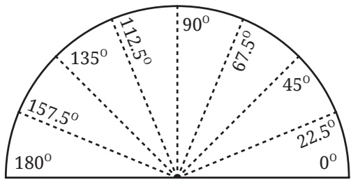

4. Fold the sheet again as shown in Figs. 2.16 and 2.17:

Fig. 2.16

Fig. 2.17

When folded, this is $\frac { 1 } { 8 }$ of the circle, or $\frac { 1 } { 8 }$ of a turn, or $\frac { 1 } { 8 }$ of $3 6 0 \%$ or $\frac { 1 } { 4 }$ of $1 8 0 ^ { \circ }$ or $\frac { 1 } { 2 }$ of ${ \dot { 9 } } 0 ^ { \circ } =$

The new creases formed give us measures of $4 5 ^ { \circ }$ and $1 8 0 ^ { \circ } - 4 5 ^ { \circ } = 1 3 5 ^ { \circ }$ as shown. Write $4 5 ^ { \circ }$ and $1 3 5 ^ { \circ }$ at the correct places on the new creases along the edge of the semicircle.

5. Continuing with another half fold as shown in Fig. 2.18, we get an angle of measure

Fig. 2.18

6. Unfold and mark the creases as OB, OC, ..., etc., as shown in Fig. 2.19 and Fig. 2.20.

Fig. 2.19

Fig. 2.20