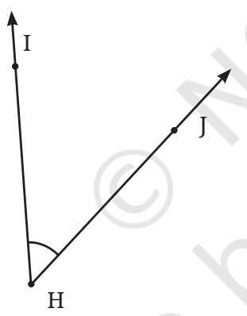
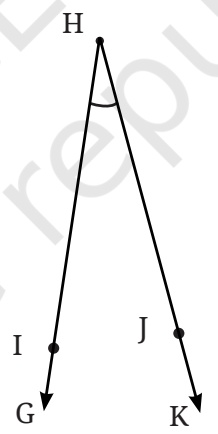
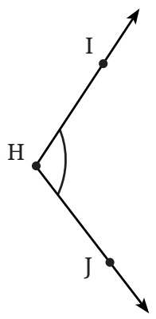

## Think!

In Fig. 2.19, we have $\angle AOB = \angle BOC = \angle COD = \angle DOE = \angle EOF = \angle FOG =$ ∠GOH = ∠HOI=\_\_\_\_\_. Why?

## Angle Bisector

At each step, we folded in halves. This process of getting half of a given angle is called **bisecting the angle**. The line that bisects a given angle is called the **angle bisector** of the angle.

Identify the angle bisectors in your handmade protractor. Try to make different angles using the concept of angle bisector through paper folding.

## Figure it Out

1. Find the degree measures of the following angles using your protractor.

2. Find the degree measures of different angles in your classroom using your protractor.

## Teacher’s Note

It is important that students make their own protractor and use it to measure different angles before using the standard protractor so that they know the concept behind the marking of the standard protractor.