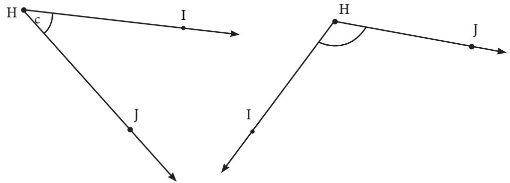
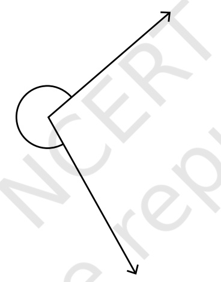
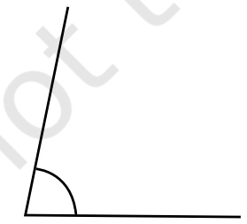
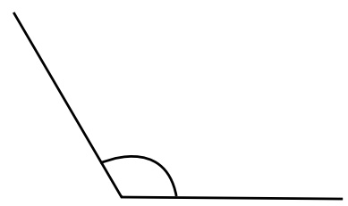

3. Find the degree measures for the angles given below. Check if your paper protractor can be used here!

4. How can you find the degree measure of the angle given below using a protractor?

5. Measure and write the degree measures for each of the following angles:

a.

b.

