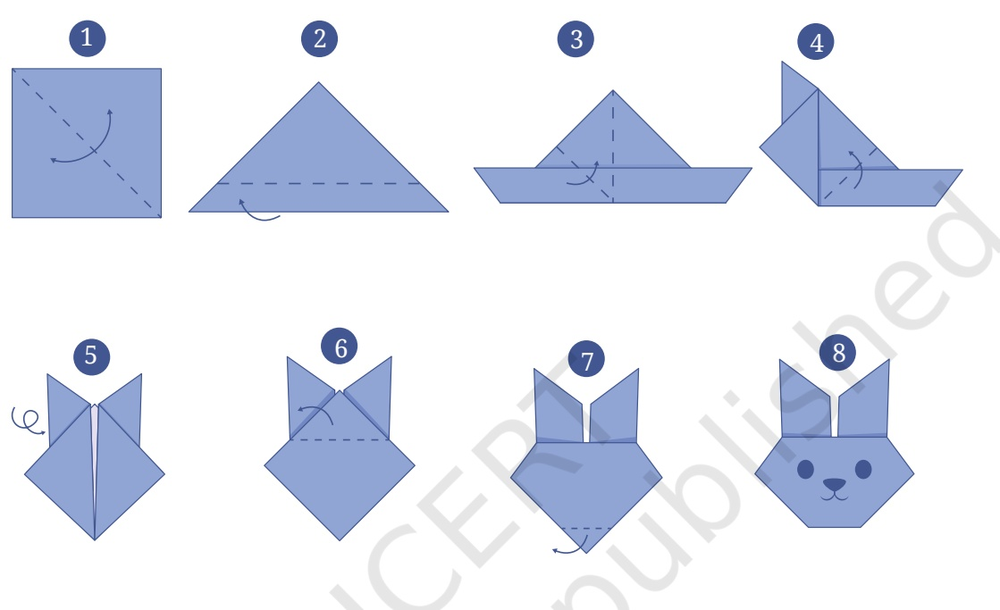
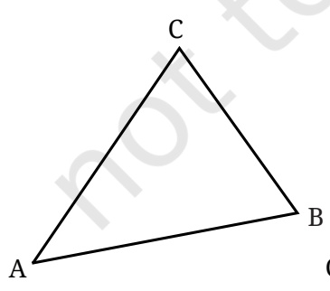
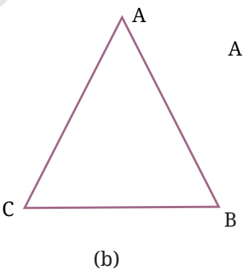
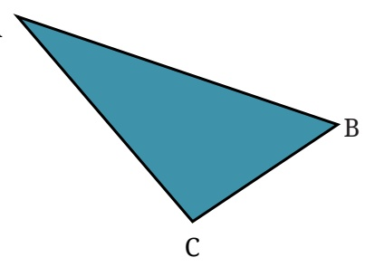

8. Make the paper craft as per the given instructions. Then, unfold and open the paper fully. Draw lines on the creases made and measure the angles formed.

9. Measure all three angles of the triangle shown in Fig. 2.21 (a), and write the measures down near the respective angles. Now add up the three measures. What do you get? Do the same for the triangles in Fig. 2.21 (b) and (c). Try it for other triangles as well, and then make a conjecture for what happens in general! We will come back to why this happens in a later year.

(a)

Fig. 2.21

(c)