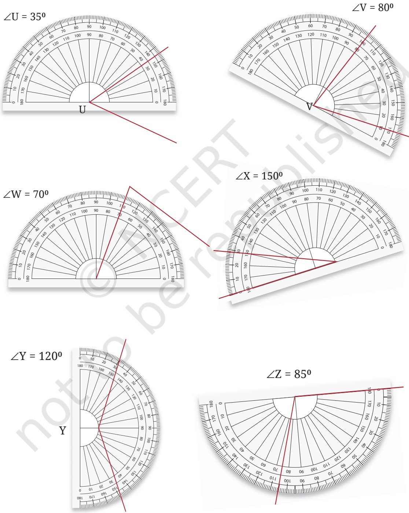

## Mind the Mistake, Mend the Mistake!

A student used a protractor to measure the angles as shown below. In each figure, identify the incorrect usage(s) of the protractor and discuss how the reading could have been made and think how it can be corrected.

