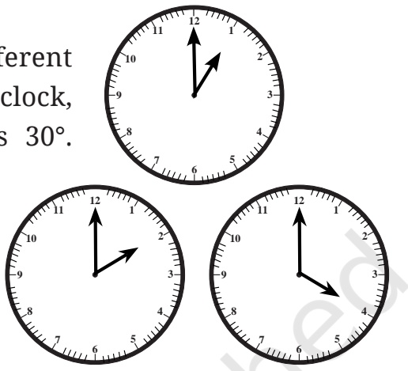
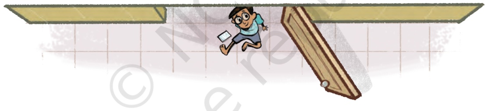
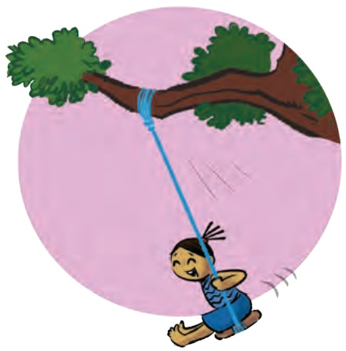

## Figure it Out

Where are the angles?

1. Angles in a clock:

a. The hands of a clock make different angles at different times. At 1 o’clock, the angle between the hands is 30°. Why?

b. What will be the angle at 2 o’clock? And at 4 o’clock? 6 o’clock?

c. Explore other angles made by the hands of a clock.

2. The angle of a door:

Is it possible to express the amount by which a door is opened using an angle? What will be the vertex of the angle and what will be the arms of the angle?

3. Vidya is enjoying her time on the swing. She notices that the greater the angle with which she starts the swinging, the greater is the speed she achieves on her swing. But where is the angle? Are you able to see any angle?

