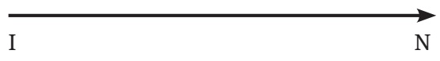
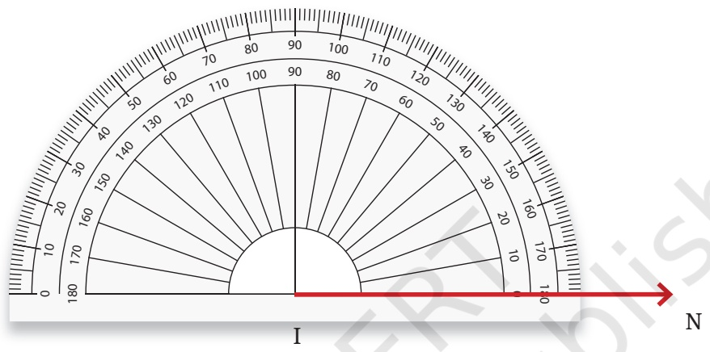
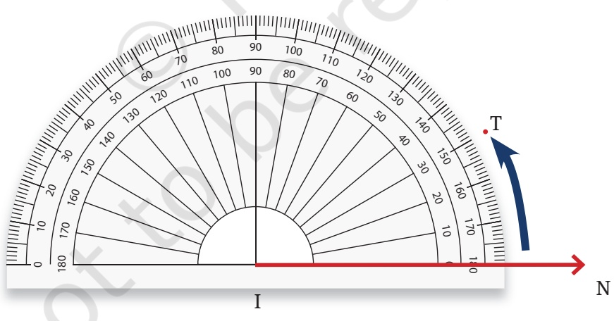

**Step 1:** We begin with the base and draw $\begin{array}{c}\rightarrow \\ \overrightarrow{IN};\end{array}$

**Step 2:** We will place the centre point of the protractor on I and align IN to the 0 line.

Step 3: Now, starting from 0, count your degrees (0, 10, 30) up to 30 on the protractor. Mark point T at the label 30°.

Step 4: Using a ruler join the point I and T. $\angle \mathrm{TIN} = 30^{\circ}$ is the required angle.