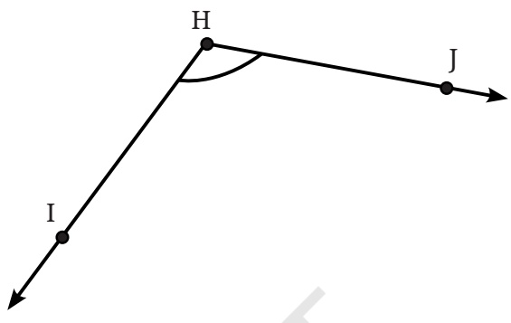
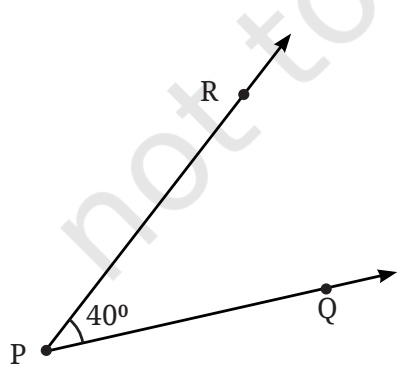
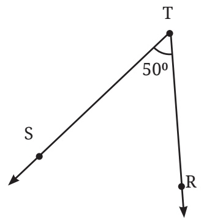
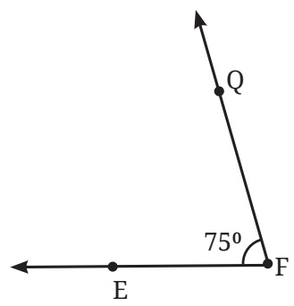

2. Use a protractor to draw angles having the following degree measures: a. $1 1 0 ^ { \circ }$ b. $4 0 ^ { \circ }$ c. $7 5 ^ { \circ }$ d. $1 1 2 ^ { \circ }$ e. $1 3 4 ^ { \circ }$

3. Draw an angle whose degree measure is the same as the angle given below:

Also, write down the steps you followed to draw the angle.

## 2.11 Types of Angles and their Measures

We have read about different types of angles in this chapter. We have seen that a straight angle is $1 8 0 ^ { \circ }$ and a right angle is $9 0 ^ { \circ }$ . How can other types of angles — acute and obtuse — be described in terms of their degree measures?

**Acute Angle:** Angles that are smaller than the right angle, i.e., less than $9 0 ^ { \circ }$ and are greater than $0 ^ { \circ } ,$ , are called **acute** angles.

Examples of acute angles

