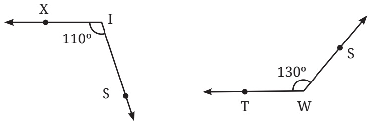
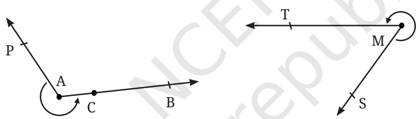

**Obtuse Angle:** Angles that are greater than the right angle and less than the straight angle, i.e., greater than $9 0 ^ { \circ }$ and less than $1 8 0 ^ { \circ }$ , are called **obtuse** angles.

Examples of obtuse angles

Have we covered all the possible measures that an angle can take? Here is another type of angle.

**Reflex angle:** Angles that are greater than the straight angle and less than the whole angle, i.e., greater than $1 8 0 ^ { \circ }$ and less than $3 6 0 ^ { \circ } ]$ , are called **reflex** angles.

Examples of reflex angles

## Figure it Out

1. In each of the below grids, join A to other grid points in the figure by a straight line to get:

a. An acute angle

····· ··