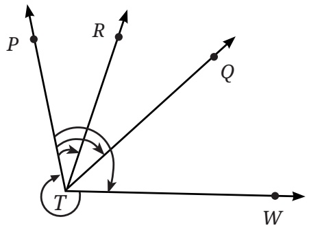

b. An obtuse angle

$$
\begin{array} { c c c c c c c } { \bullet } & { \bullet } & { \bullet } & { \bullet } & { \bullet } & { \bullet } & { \bullet } & { \bullet } \\ { \bullet } & { \bullet } & { \bullet } & { \bullet } & { \bullet } & { \bullet } & { \bullet } & { \bullet } \\ { \bullet } & { \bullet } & { \bullet } & { \bullet } & { \bullet } & { \bullet } & { \bullet } & { \bullet } \\ { \bullet } & { \bullet } & { \bullet } & { \bullet } & { \bullet } & { \bullet } & { \bullet } & { \bullet } \\ { \bullet } & { \bullet } & { \bullet } & { \bullet } & { \bullet } & { \bullet } & { \bullet } & { \bullet } \\ { \bullet } & { \bullet } & { \bullet } & { \bullet } & { \bullet } & { \bullet } & { \bullet } \\ { \bullet } & { \bullet } & { \bullet } & { \bullet } & { \bullet } & { \bullet } & { \bullet } \\ \end{array}
$$

c. A reflex angle

$$
\begin{array} { c c c c c } { \bullet } & { \bullet } & { \bullet } & { \bullet } & { \bullet } \\ { \bullet } & { \bullet } & { \bullet } & { \bullet } & { \bullet } \\ { \bullet } & { \bullet } & { \bullet } & { \bullet } & { \bullet } \\ { \bullet } & { \bullet } & { \bullet } & { \bullet } & { \bullet } \\ { \bullet } & { \bullet } & { \bullet } & { \bullet } & { \bullet } \\ { \bullet } & { \bullet } & { \bullet } & { \bullet } & { \bullet } \\ \end{array}
$$

Mark the intended angles with curves to specify the angles. One has been done for you.

2. Use a protractor to find the measure of each angle. Then classify each angle as acute, obtuse, right, or reflex. a. ∠PTR b. ∠PTQ c. ∠PTW d. ∠WTP

