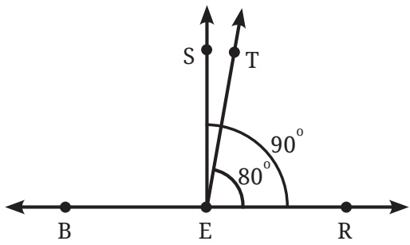
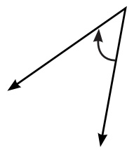
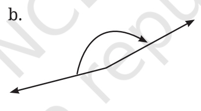
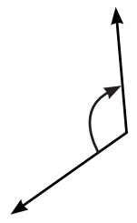
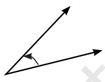
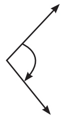
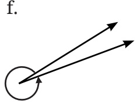

## Let’s Explore

In this figure, $\angle TER = 80^{\circ}$ . What is the measure of ∠BET? What is the measure of ∠SET?

Hint: Observe that $\angle \mathrm { R E B }$ is a straight angle. Hence, the degree measure of $\angle  REB  = 180^{\circ}$ of which $8 0 ^ { \circ }$ is covered by $\angle \mathrm { T E R } .$ A similar argument can be applied to find the measure of $\angle \mathrm { S E T } .$

## Figure it Out

1. Draw angles with the following degree measures: a. $1 4 0 ^ { \circ }$ b. $8 2 ^ { \circ }$ c. 195° d. $7 0 ^ { \circ }$ e. $3 5 ^ { \circ }$

2. Estimate the size of each angle and then measure it with a protractor:

a.

b.

c.

d.

e.

f.

Classify these angles as acute, right, obtuse or reflex angles.

3. Make any figure with three acute angles, one right angle and two obtuse angles.

4. Draw the letter ‘M’ such that the angles on the sides are $4 0 ^ { \circ }$ each and the angle in the middle is $6 0 ^ { \circ }$

5. Draw the letter ‘Y’ such that the three angles formed are $1 5 0 ^ { \circ }$ , 60° and $1 5 0 ^ { \circ }$