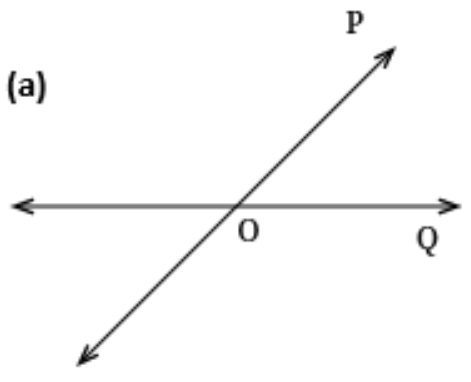
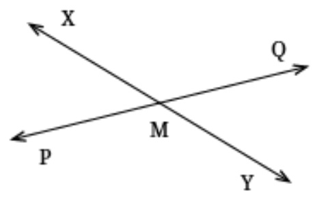
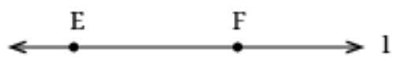
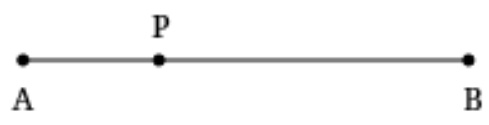

(b)

(c)

(d)

• D

**Q.5. In Fig. 2.6, name: a. Five points b. A line c. Four rays d. Five line segments**

Ans. a) D, E, O, B and C b) $\begin{array} { l } { { \iff \iff \iff \iff \iff \iff \iff \iff \iff \iff \iff } } \\ { { \mathrm { ~ D E ~ o r ~ D O ~ o r ~ D B ~ o r ~ E O ~ o r ~ E B ~ o r ~ O B ~ } } } \end{array}$ c) $\overrightarrow { \mathrm { o c } } , \overrightarrow { \mathrm { o } \overrightarrow { \mathrm { s } } } , \overrightarrow { \mathrm { o } \overrightarrow { \mathrm { e } } } , \overrightarrow { \mathrm { o } \overrightarrow { \mathrm { b } } }$ (Try for other rays) d) $\mathrm { \overline { { D E } } , \overline { { D O } } , \overline { { D B } } , \overline { { E O } } , \overline { { E B } } \; ( \overline { { O B } } ; \; \overline { { O C } } }$ are also possible)

**Q.6. Here is a ray OA (Fig. 2.7). It starts at O and passes through the point A. It also passes through the point B. a. Can you also name it as OB? Why? b. Can we write OA as AO? Why or why not?**

Ans. a) Yes, O is the starting point and point B lies on the rays that goes endlessly in the direction of $\stackrel { \rightarrow } { \mathrm { A . O A } }$ is the extension of OB.

b) No, OA is a ray with starting point O whereas AO is a ray with starting point A.