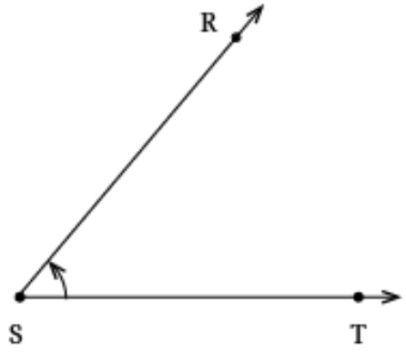
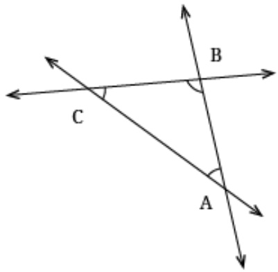

**Section 2.5**

**Page – 19**

**Figure it Out**

**Q.1. Can you find the angles in the given pictures? Draw the rays forming any one of the angles and name the vertex of the angle.**

Ans. Yes, one of the angles is ∠BDC. It’s vertex is D. One ray is $\overrightarrow { \operatorname { D C } \mathrm { a } }$ nd the other rays DB. Try for other pictures.

**Q.2. Draw and label an angle with arms ST and SR.**

Ans.

**Q.4. Name the angles marked in the given figure.**

Ans. $\angle  RTQ , \angle  RTP$

**Q.5. Mark any three points on your paper that are not on one line. Label them A, B, C. Draw all possible lines going through pairs of these points. How many lines do you get? Name them. How many angles can you name using A, B, C? Write them down, and mark each of them with a curve as in Fig. 2.9.**

$$
\Longleftrightarrow \Longleftrightarrow \Longleftrightarrow
$$

Ans. We get three lines AB, BC, CA.

Using A, B & C we can name three angles: ∠ABC or $\angle \mathbf { C B A } ,$ ∠BCA or $\angle \mathbf { A C B }$ & ∠CAB or ∠BAC.