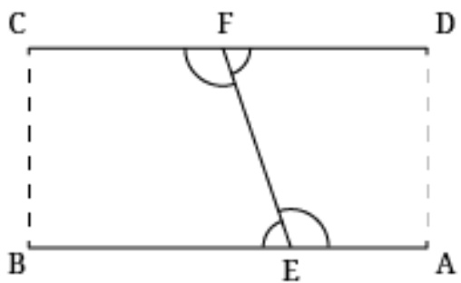

Ans.

Angles Formed: $\angle  AEF , \angle  BEF , \angle  DFE , \angle  CFE$ Here $\angle  AEF$ & ∠CFE are larger than ∠BEF & ∠DFE Try more cases by folding rectangular sheets in different ways.

**Q.2. In each case, determine which angle is greater and why.** a. $\angle \mathrm{AOB}   or   \angle \mathrm{XOY}$ b. $\angle \mathbf{AOB}   or   \angle \mathbf{XOB}$ c. ∠**XOB** or ∠**XOC**

**Discuss with your friends on how you decided which one is greater.** Ans. (a)- $\angle  AOB ; \angle  XOY$ is an acute angle and $\angle AOB = \angle AOX + \angle XOY + \angle YOB$ (b)- $\angle \mathrm { A O B }$ (c) – $- \mathrm{None} . \angle \mathrm{XOB} = \angle \mathrm{XOC}$

**Q.3. Which angle is greater:** ∠**XOY or** ∠**AOB? Give reasons.**

Ans. By looking at the figure we cannot say. Superimposition or measurement is necessary here.

## Section 2.8

**Page 28**

**Q. Is it possible to draw** $\overset { \rightarrow } { \mathbf { o c } }$ **such that the two angles are equal to each other in size?** Ans. Yes, when $\overrightarrow { \mathrm { O A } }$ and $\overrightarrow { \mathbf { O B } }$ overlap each other on folding the Vidya’s notebook, the crease OC will divide $\angle \mathbf { A O B }$ in two equal sized angles.

**Page 29**

**Q. If a straight angle is formed by half of a full turn, how much of a full turn will form a right angle?**

Ans. ${ \frac { 1 } { 4 } }   \mathrm { o f }$ a full turn.