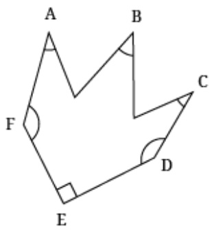
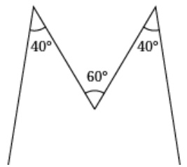
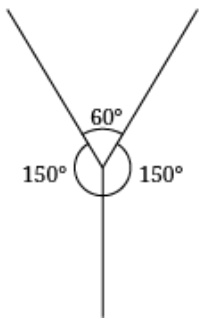

**Q.4. Draw the letter** $\mathbf { ^ { \circ } M ^ { \circ } }$ **such that the angles on the sides are** $4 0 ^ { \circ }$ **each and the angle in** the middle is $\mathbf { 6 0 ^ { \circ } }$

Ans.

Q.5. Draw the letter ‘Y’ such that the three angles formed are $\mathbf { 1 5 0 ^ { \circ } ,   6 0 ^ { \circ } }$ and $\mathbf { 1 5 0 ^ { \circ } } .$ Ans.

**Q.6. The Ashoka Chakra has 24 spokes. What is the degree measure of the angle between two spokes**

**next to each other? What is the largest acute angle formed between two spokes?** Ans. The angle between two spokes next to each other is $1 5 ^ { \circ }$ . Largest acute angle between spokes is $7 5 ^ { \circ }$

**Q.7. Puzzle: I am an acute angle. If you double my measure, you get an acute angle. If you triple my measure, you will get an acute angle again. If you quadruple (four times) my measure, you will get an acute angle yet again! But if you multiply my measure by** $5 ,$ **you will get an obtuse angle measure. What are the possibilities for my measure?**

Ans. The acute angle can be 19º, 20º, 21º & 22º.