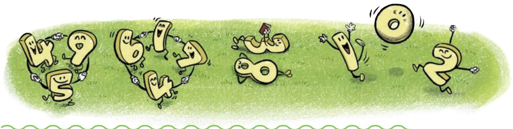
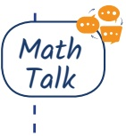
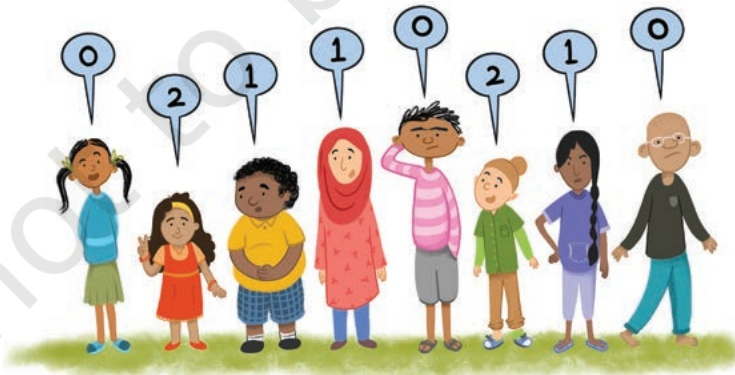

## NUMBER PLAY

0674CH03

Numbers are used in different contexts and in many different ways to organise our lives. We have used numbers to count, and have applied the basic operations of addition, subtraction, multiplication and division on them, to solve problems related to our daily lives.

In this chapter, we will continue this journey, by playing with numbers, seeing numbers around us, noticing patterns, and learning to use numbers and operations in new ways.

Think about various situations where we use numbers. Math List five different situations in which numbers are used. See what Talk your classmates have listed, share, and discuss.

## 3.1 Numbers can Tell us Things

## What are these numbers telling us?

Some children in a park are standing in a line. Each one says a number.

What do you think these numbers mean?

The children now rearrange themselves, and again each one says a number based on the arrangement.