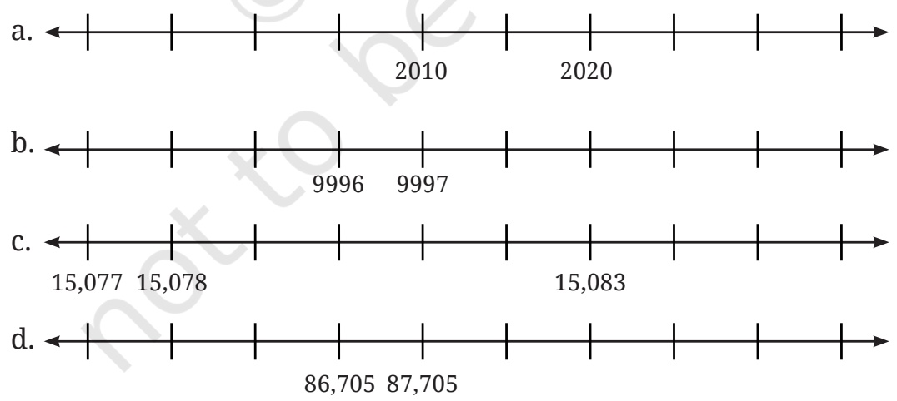
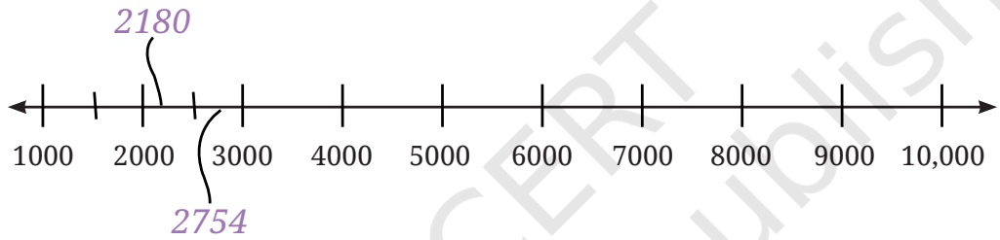

The smallest even number in the table is

The smallest number greater than 50,000 in the table is

Once you have filled the table above, put commas appropriately after the thousands digit.

## 3.3 Patterns of Numbers on the Number Line

We are quite familiar with number lines now. Let’s see if we can place some numbers in their appropriate positions on the number line. Here are the numbers: 2180, 2754, 1500, 3600, 9950, 9590, 1050, 3050, 5030, 5300 and 8400.

## Figure it Out

Identify the numbers marked on the number lines below, and label the remaining positions.

Put a circle around the smallest number and a box around the largest number in each of the sequences above.