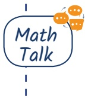
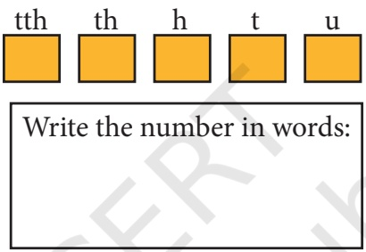
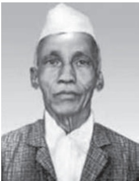

you get a palindrome. There are numbers for which you have to repeat this a large number of times.

Are there numbers for which you do not reach a palindrome at all?

## Explore

Will reversing and adding numbers repeatedly, starting with a 2-digit number, always give a palindrome? Explore and find out.\*

## Puzzle time

I am a 5-digit palindrome.

I am an odd number.

My ‘t’ digit is double of my ‘u’ digit.

My ‘h’ digit is double of my ‘t’ digit.

Who am I? \_\_\_\_

## 3.6 The Magic Number of Kaprekar

D.R. Kaprekar was a mathematics teacher in a government school in Devlali, Maharashtra. He liked playing with numbers very much and found many beautiful patterns in numbers that were previously unknown.

In 1949, he discovered a fascinating and magical phenomenon when playing with 4-digit numbers.

<small>\*The answer is yes! For 3-digit numbers the answer is unknown. It is suspected that starting with 196 never yields a palindrome!</small>