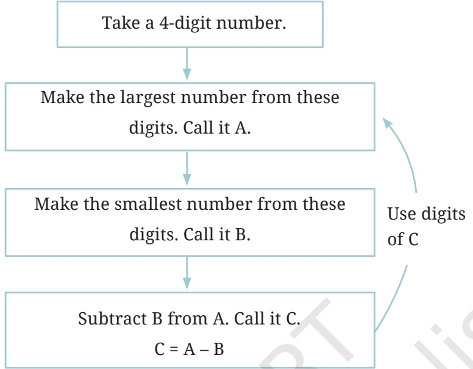

Follow these steps and experience the magic for yourselves! Pick any 4-digit number having at least two different digits, say 6382.

Take a 4-digit number.

Make the largest number from these digits. Call it A.

Make the smallest number from these digits. Call it B.

What happens if we continue doing this?

A = 8632

A = 6642

$$
\mathrm{A} = 7641
$$

$$
\mathrm { A } =
$$

B = 2368

B = 2466

$$
\mathrm { B } = 1 4 6 7
$$

$$
\mathtt { B } =
$$

$$
c = 8632 - 2368
$$

C = 6642–2466

$$
C = 7641{-}1467
$$

$$
\mathbb { C } =
$$

$$
= 6 2 6 4
$$

$$
= 4 1 7 6
$$

$$
= 6 1 7 4
$$

Explore

Take different 4-digit numbers and try carrying out these steps. Find out what happens. Check with your friends what they got.

**You will always reach the magic number ‘6174’! The number ‘6174’ is now called the ‘Kaprekar constant’**.

Carry out these same steps with a few 3-digit numbers. What number will start repeating?